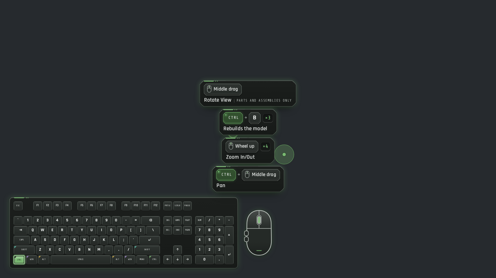
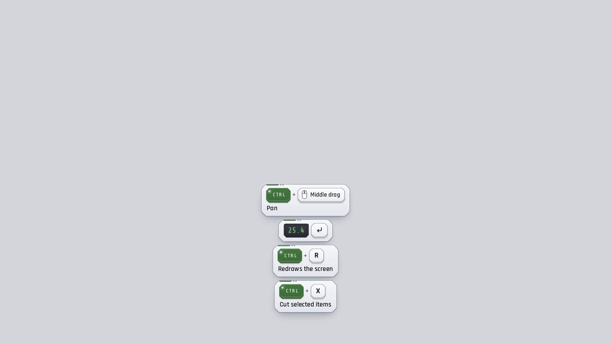

# IDEA Keystage

IDEA Keystage shows your keystrokes, a keyboard and your mouse on screen while you record SolidWorks tutorials on Windows 10 or 11 (64-bit). It draws them in its own see-through overlay on top of SolidWorks, or as OBS Browser Sources you place in your scenes, or both. In SolidWorks it names each shortcut with the command Dassault's own documentation gives for it (`Ctrl + B` "Rebuilds the model", middle drag "Rotate View"), and outside SolidWorks it shows only shortcuts, never what you type. It works on this computer only: no account, no telemetry, no update checks, and nothing at all while a password field has focus. It was built for the IDEA engineering pathway.





## Download and install

Get the newest version from **https://github.com/pina-hash/idea-keystage/releases/latest**.

| File                                       | What it is                                                                                                                                                 |
| ------------------------------------------ | ---------------------------------------------------------------------------------------------------------------------------------------------------------- |
| `IDEA-Keystage_<version>_x64-setup.exe`    | The installer (recommended). Installs for your Windows account only, so it needs no administrator rights. Adds a Start menu entry and an uninstaller.      |
| `IDEA-Keystage_<version>_x64-portable.exe` | The portable app. One file, nothing installed. Keep it in a folder you own and run it from there.                                                          |
| `SHA256SUMS.txt`                           | Checksums of both files. In PowerShell: `Get-FileHash .\IDEA-Keystage_<version>_x64-setup.exe -Algorithm SHA256`, then compare with the line in this file. |

**SmartScreen.** The files are not code signed yet, so Windows may say "Windows protected your PC" the first time you run one. Click **More info**, then **Run anyway**.

**WebView2.** IDEA Keystage draws its windows with Microsoft Edge WebView2. Windows 11 includes it, and most Windows 10 computers already have it. The installer installs it if it is missing (that step needs an internet connection during setup). The portable app cannot install it: if the portable app does not open, install the Evergreen WebView2 Runtime from https://developer.microsoft.com/en-us/microsoft-edge/webview2/ or use the installer.

To uninstall, open Windows Settings, then Apps, then Installed apps.

## First run

1. Start IDEA Keystage from the Start menu. The first-run setup has four steps: which monitor to use, the look (theme and keyboard), whether you record with OBS sources, the on-screen overlay or both, and a summary of what you chose. Press **Finish**.
2. IDEA Keystage now runs in the notification area (the tray). A left click on its icon opens the settings window. The right-click menu has Pause, Keyboard visual, SolidWorks mode, Native overlay, Start session log, Add chapter marker, Open settings and Quit IDEA Keystage.
3. Open SolidWorks and press `F` in a part window. The overlay shows `F` with the caption "Zooms to fit". The SolidWorks profile turns on by itself whenever SolidWorks is the app in front (SolidWorks mode **Auto**).

The settings window has a live preview of the overlay and pages for Keystrokes, Keyboard, Mouse, Display, OBS, SolidWorks, Sessions, Privacy, Hotkeys, Sound and General. Changes save as you make them.

## OBS setup

IDEA Keystage serves five overlay pages to OBS from `http://127.0.0.1:47820` (this computer only). Add one Browser Source per page you want. The OBS page in settings shows the exact address and size for your monitor and settings, with Copy buttons.

**In OBS: Sources, +, Browser.** Then set these fields:

| Field                                     | Value                                                                                                 |
| ----------------------------------------- | ----------------------------------------------------------------------------------------------------- |
| Local file                                | Off                                                                                                   |
| URL                                       | The source's address from the table below                                                             |
| Width, Height                             | The source's size from the table below (or from the OBS page in settings)                             |
| Use custom frame rate                     | Off                                                                                                   |
| Control audio via OBS                     | Off                                                                                                   |
| Custom CSS                                | Leave the default: `body { background-color: rgba(0, 0, 0, 0); margin: 0px auto; overflow: hidden; }` |
| Shutdown source when not visible          | Off                                                                                                   |
| Refresh browser when scene becomes active | Off                                                                                                   |

**The five sources** (sizes for a 1920 x 1080 monitor with the default settings):

| Source     | URL                                       | Width | Height | What it draws                                                               |
| ---------- | ----------------------------------------- | ----- | ------ | --------------------------------------------------------------------------- |
| Keystrokes | `http://127.0.0.1:47820/overlay/keys`     | 884   | 632    | The keystroke callouts and the Paused and Hidden pills                      |
| Keyboard   | `http://127.0.0.1:47820/overlay/keyboard` | 1112  | 352    | The keyboard visual, with the mouse beside it                               |
| Mouse      | `http://127.0.0.1:47820/overlay/mouse`    | 168   | 224    | The mouse diagram on its own                                                |
| Cursor     | `http://127.0.0.1:47820/overlay/cursor`   | 1920  | 1080   | Cursor highlight, click ripples and the drag trail, the size of the monitor |
| Everything | `http://127.0.0.1:47820/overlay/all`      | 1920  | 1080   | Every piece that is turned on, in one source the size of the monitor        |

For a 3840 x 2160 canvas, set Scale to 2 in settings (or add `?scale=2` to the URL) and use Keystrokes 1768 x 1262, Keyboard 2224 x 704, Mouse 334 x 448, Cursor and Everything 3840 x 2160. The Keyboard size changes with the layout (tenkeyless 950 x 352, left-hand zone 666 x 352 at 1080p); the OBS page always shows the current numbers.

With the output set to **Both** in the first-run setup, the on-screen overlay steps aside while an OBS source is connected, so nothing is drawn twice; turn off **Step aside for OBS** on the Display page to keep it on screen anyway.

A source that cannot reach the app stays fully transparent in OBS and reconnects by itself, so a waiting message is never recorded. Open the same address in a browser to see a "Waiting for IDEA Keystage" card instead.

**Settings in the URL.** Each source can override the app's settings for itself, so one source is fully described by its address. Add them after `?`, joined with `&`, for example `http://127.0.0.1:47820/overlay/keys?theme=studio&anchor=top-right&x=48&y=48`.

| Parameter | Values                                                                                             | What it changes                                                                                                                                                            |
| --------- | -------------------------------------------------------------------------------------------------- | -------------------------------------------------------------------------------------------------------------------------------------------------------------------------- |
| `theme`   | `idea`, `studio`, `graphite`, `blueprint`, `carbon`, `glass`, `custom`                             | The color theme                                                                                                                                                            |
| `scale`   | 0.25 to 4                                                                                          | Overall size (1 is sized for 1080p)                                                                                                                                        |
| `anchor`  | `top-left`, `top`, `top-right`, `left`, `center`, `right`, `bottom-left`, `bottom`, `bottom-right` | Where the piece sits: the callouts on `keys` and `all`, the keyboard on `keyboard`, the diagram on `mouse` (ignored on `cursor`). Top anchors stack new callouts downward. |
| `x`, `y`  | -4000 to 4000                                                                                      | Distance in pixels from the anchored edge (at scale 1)                                                                                                                     |
| `kb`      | `full`, `tkl`, `75`, `60`, `laptop`, `left`                                                        | Keyboard layout                                                                                                                                                            |
| `stack`   | 1 to 12                                                                                            | How many callouts show at once                                                                                                                                             |
| `size`    | `s`, `m`, `l`, `xl` on `keys` and `all`; `s`, `m`, `l` on `keyboard`                               | Callout size, or keyboard size                                                                                                                                             |
| `demo`    | `1`                                                                                                | Plays a built-in demo instead of live input (for setting up a scene)                                                                                                       |
| `status`  | `1`                                                                                                | Shows the connection card even inside OBS                                                                                                                                  |

**Recording timecodes and chapters (optional).** To have Session Logs follow your OBS recording time and to add chapter markers to the recording file: in OBS open Tools > WebSocket Server Settings, check Enable WebSocket server, keep Enable Authentication on, click Show Connect Info and copy the password. In IDEA Keystage, open the OBS page, turn on Connect to OBS, paste the password and click Save password (port 4455 unless you changed it). Chapter markers reach the recording file only with the Hybrid MP4 format (or Hybrid MOV in OBS 32); they are always kept in the Session Log.

## The SolidWorks profile

- **Where the captions come from.** Every caption is taken from Dassault's SOLIDWORKS help for 2025 and 2026 (help.solidworks.com) and stored in `data/profiles/solidworks.json` with its page, version, date read and a verbatim quote: 364 keyboard entries and 183 mouse entries from 294 help pages. Nothing was written from memory. A caption that applies only in one place (a sketch, a dialog, the walk-through) shows that context in small type.
- **What is covered.** The Selected Keyboard Shortcuts table, view and zoom keys (`F`, `Z`, `Shift + Z`, Spacebar for the View Selector), rebuild, save, undo, selection filters, search, middle-button rotate, pan, zoom and roll, wheel zoom, and mouse gestures where the 2026 tutorial names them.
- **What is not.** Dassault does not publish a complete list of default shortcuts. The `Ctrl + 1` to `Ctrl + 8` standard view keys appear only in a 2025 screenshot (they are included, marked as screenshot evidence, and shown for both versions because the app cannot tell 2025 from 2026); no 2026 page documents them. Also undocumented: a middle-button double-click, which wheel direction zooms in, and the factory mouse gesture assignments. All 17 gaps are listed in `docs/DECISIONS.md` item 3.
- **Your own shortcuts.** To get captions for everything you have bound, import your list from SolidWorks: in SolidWorks open **Tools, Customize, Keyboard**, set **Category** to **All Commands** and click **Copy List**. In IDEA Keystage open the SolidWorks page, paste into the import box (or save the list in Notepad as a `.txt` and load it), look over the preview of added and changed captions, and apply. Your imported captions win over the documentation for the same keys. A `.sldreg` file from the SolidWorks Settings Wizard can be loaded too, but its format is not documented, so it is experimental. Both importers are marked unvalidated until they are checked against real exports from SolidWorks 2025 and 2026.
- **SolidWorks mode.** Auto (on while SolidWorks is in front), On, or Off, from the tray, the hotkey, or the SolidWorks page. In SolidWorks, single-key shortcuts and typed values (such as `25.4 Enter`) show; turn **Typed values** or **Mouse captions** off on the SolidWorks page if you prefer.

## Privacy

IDEA Keystage has to see your keyboard and mouse to show them. Here is exactly what it does with that.

- **What it watches.** It installs the standard Windows low-level keyboard and mouse hooks, which see every key and mouse event while the app runs and is not paused. It also checks which app is in front and whether the focused field is a password field.
- **What it shows.** Outside SolidWorks it shows only shortcuts (`Ctrl + S`, `F5`, `Esc`): ordinary typing appears as a single "Typing" callout with no letters, and the keyboard visual does not light the keys you type. While SolidWorks is in front it also shows single-key shortcuts and the text you type there, such as dimension values (`25.4 Enter`), because that is part of a tutorial. To mask typing in SolidWorks too, turn typed values off on the SolidWorks page.
- **When it shows nothing.** While a password field has focus, while a password manager or Windows sign-in screen is in front (Privacy page, editable list), while the computer is locked, and while paused. Pausing (`Ctrl+Alt+Shift+P` or the tray) removes the hooks completely. Right after you move to a new field, keys are held back until Windows confirms it is not a password field; if that cannot be confirmed, they are dropped. If password detection cannot start at all, typing is masked everywhere (shown only as "Typing", in SolidWorks too) and the app tells you.
- **What it keeps.** Your settings (in `%APPDATA%\com.ideabosco.keystage`), a small log of app events with no keys, text or captions (in `%LOCALAPPDATA%\com.ideabosco.keystage\logs`), and Session Logs only when you start one, or when OBS starts recording while Connect to OBS and "Session log with each recording" (on by default) are on. A Session Log holds only the callouts that were on screen and your chapter markers, saved as JSON in `Documents\IDEA Keystage\Sessions`. Nothing else you type is ever written to disk.
- **What it never does.** It makes no internet connection: no telemetry, no update check, no account. Its overlay server listens only on `127.0.0.1` (this computer) and refuses web pages from anywhere else. It connects to OBS only if you turn that on. Your OBS password is stored encrypted with Windows DPAPI for your account and is left out of settings exports.

## Hotkeys

| Action                              | Default            |
| ----------------------------------- | ------------------ |
| Pause or resume (removes the hooks) | `Ctrl+Alt+Shift+P` |
| Show or hide the keyboard visual    | `Ctrl+Alt+Shift+K` |
| SolidWorks mode (Auto, On, Off)     | `Ctrl+Alt+Shift+S` |
| Add a chapter marker                | `Ctrl+Alt+Shift+M` |
| Start or stop a session log         | `Ctrl+Alt+Shift+L` |

Change them on the Hotkeys page. The app's own hotkeys never appear in the overlay. If another program already holds one, the Home page says so.

## Session logs and exports

Start a session log before you record (hotkey, tray or the Sessions page), or, with Connect to OBS on, let a log start and stop with each OBS recording ("Session log with each recording" on the OBS page, on by default). On the Sessions page, export a log as subtitles (`.srt`), a Markdown list "Shortcuts used in this video", the raw JSON, or YouTube chapter lines. The format is documented in `docs/SESSION_FORMAT.md`.

## Building from source

You need Node 22.12 or later and Rust 1.97.0 (`rustup toolchain install 1.97.0`). On Windows you also need the Microsoft C++ build tools and WebView2.

```sh
npm ci
npm run check          # type check (svelte-check)
npm test               # front-end tests (Vitest)
npm run build          # build the overlay and settings pages into dist/
cargo test             # Rust tests for the core, session, server and OBS crates
cargo clippy --all-targets -- -D warnings
npm run tauri dev      # run the app (Windows)
npm run tauri build    # build the NSIS installer (Windows)
```

The app crate (`src-tauri`) is left out of a plain `cargo test`; run `cargo test -p idea-keystage` for it. From Linux you can check and cross-build the Windows app with `cargo xwin check -p idea-keystage --target x86_64-pc-windows-msvc` and `npx tauri build --runner cargo-xwin --target x86_64-pc-windows-msvc --bundles nsis` (needs `cargo-xwin` and `nsis`). To see the overlay in a browser without Windows, run `npm run build`, then `cargo run -p keystage-server --example demo -- --port 47820 --dist dist` and open `http://127.0.0.1:47820/overlay/all`. `npm run shots` and `npm run perf` run the screenshot and latency harnesses. More in `CLAUDE.md`.

## Where the docs live

- `docs/ARCHITECTURE.md`: how the app is put together, the wire protocol, settings and the privacy rules.
- `docs/DECISIONS.md`: the research behind every choice, with sources, plus build decisions and measured performance.
- `docs/SESSION_FORMAT.md`: the session file format and exports.
- `docs/PARITY.md`: feature comparison with Keystro.
- `docs/SOURCES.md`: every external source, the design port, fonts and audio.
- `docs/ROADMAP.md`: what comes next.
- `docs/history/` and `docs/prompt-ledger/`: what each build bundle did.
- `data/profiles/solidworks.json`: the sourced SolidWorks data, with every source listed.
